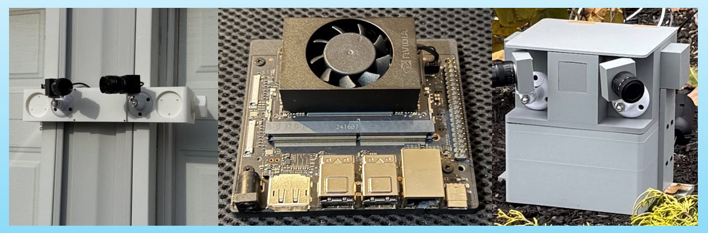

# JetsonLPR

This is the implementation of [EasyLPR](https://easylpr.com/) using NVIDIA Jetson Orin Nano development board.

## Files

- `jetsonlpr.py` — all-in-one Jetson LPR service
- `streamlit-client.py` — browser live-video viewer
- `config.example.txt` — example configuration
- `requirements.txt` — pip packages for the lightweight Python dependencies
- `best_lpr_800x800.pt` — YOLOv8 trained plate detection model
- `lpr_mobilevit.py` — MobileViT OCR algorithm
- `lpr_backend_service.py` — MobileViT OCR api
- `configs/us_multi_v4_20251003_ny7_norm.yaml` — OCR config file
- `runs/T22.8K_V2.5K_125.ckpt` — MobileViT OCR model

## Install in a Python venv

```bash
python3 -m venv --system-site-packages .venv
source .venv/bin/activate
pip install -r requirements.txt
```

## Special installation steps for torch/torchvision for Jetson

```bash
pip uninstall torch torchvision
pip install torchvision-0.23.0-cp310-cp310-linux_aarch64.whl
pip install torch-2.8.0-cp310-cp310-linux_aarch64.whl
```

Plese refer to [NVIDIA Forum](https://forums.developer.nvidia.com/t/torch-2-8-wheel-for-jetpack-6-2-1/347015/6) to download the correct versions of torch/torchvision for your Jetson environment.

## Config

Copy the example config and edit it:

```bash
cp config.example.txt config.txt
```

Minimal camera/Discord example:

```txt
DISCORD_BOT_TOKEN="xxxxxxxxxxxxxxxxxxxxxxxx"
DISCORD_USER_ID="123456789012345678,234567890123456789"
STREET="123-JohnDoe-Ave"
CITY="ABC-NY-10001"
CAM0="LPR"
DEV0="/dev/video0"
CAM1="LPR"
DEV1="/dev/video2"
SOCKET_PATH="/tmp/camera.sock"
DISCORD_FRAME_X="1024"
DISCORD_FRAME_Y="576"
```

Only USB cameras are supported in this build. The Streamlit viewer lists cameras whose `DEVx` starts with `/dev/video` and whose `CAMx` is `LPR`.

## Run JetsonLPR

Please make sure to add in your Discord bot token and user id before launching jetsonlpr program.

```bash
source .venv/bin/activate
python jetsonlpr.py
```

Or point to another config file:

```bash
JETSONLPR_CONFIG=/path/to/config.txt python jetsonlpr.py
```

## Run the Streamlit live viewer

```bash
source .venv/bin/activate
streamlit run streamlit-client.py --server.port 8501 --logger.level info
```

To use a non-default config path:

```bash
JETSONLPR_CONFIG=/path/to/config.txt streamlit run streamlit-client.py --server.port 8501 --logger.level info
```

To load live video from a browser, just type in URL ```http://<jetson-ip-address>:8501```

## Output layout

Video frames are saved to:

- `video_frames/YYYY.MM.DD/`

Each video frame generates three files:

- `..._FRAME.jpg` — original full frame
- `..._FRAME_<DISCORD_FRAME_X>x<DISCORD_FRAME_Y>.jpg` — Discord preview image, default `1024x576`
- `..._PLATE.jpg` — cropped plate image

## License

This project is released under the MIT License. It is provided to encourage research, education, and community collaboration in AI-powered residential security systems.
